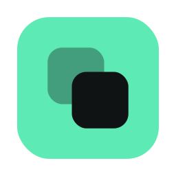
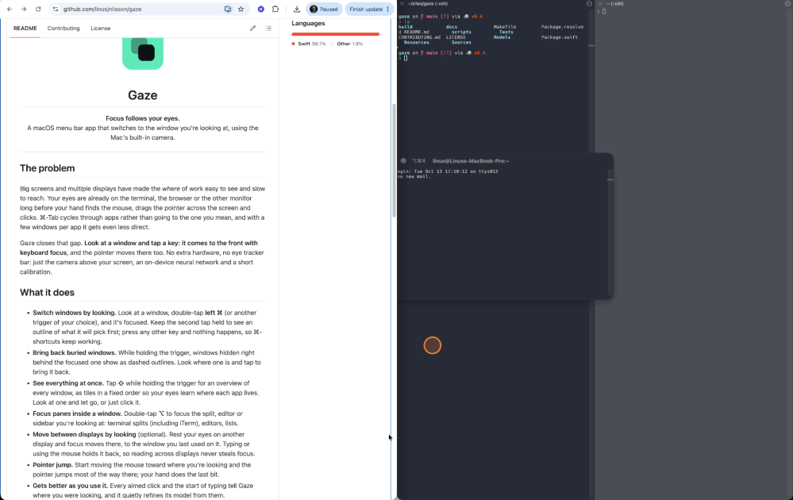
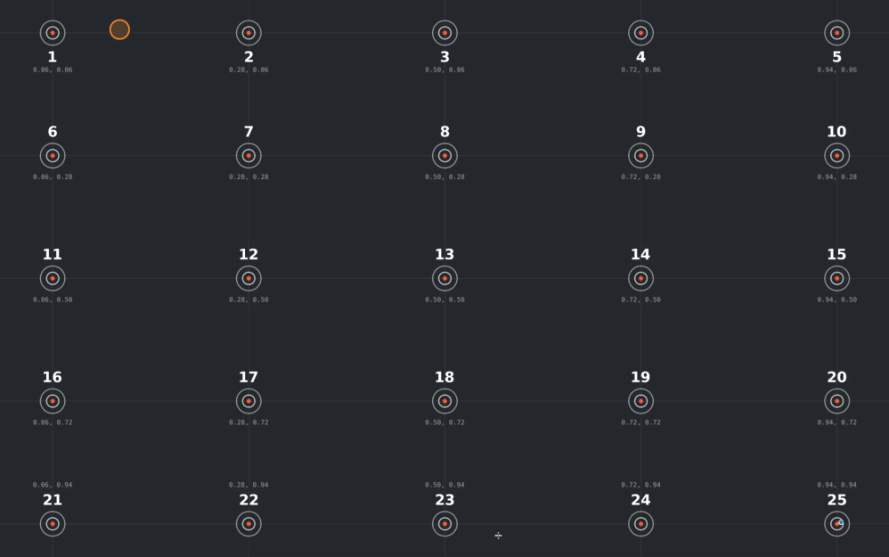

<p align="center">
  
</p>

<h1 align="center">Gaze</h1>

<p align="center"><b>Focus follows your eyes.</b><br>
A macOS menu bar app that switches to the window you're looking at, using the Mac's built-in camera.</p>

<p align="center">
  
</p>

<p align="center"><sub>Look, double-tap left ⌘, and the window you're looking at comes to the front; double-tap ⌥
to focus a pane inside it. The orange dot is where Gaze thinks I'm looking.
<a href="docs/media/gaze-demo.mp4">Sharper video (MP4)</a></sub></p>

---

## The problem

Big screens and multiple displays have made the *where* of work easy to see and slow to reach. Your
eyes are already on the terminal, the browser or the other monitor long before your hand finds the
mouse, drags the pointer across the screen and clicks. ⌘-Tab cycles through apps rather than going
to the one you mean, and with a few windows per app it gets even less direct.

Gaze closes that gap. **Look at a window and tap a key: it comes to the front with keyboard
focus**, and the pointer moves there too. No extra hardware, no eye tracker bar: just the camera
above your screen, an on-device neural network and a short calibration.

## What it does

- **Switch windows by looking.** Look at a window, double-tap **left ⌘** (or another trigger of
  your choice), and it's focused. Keep the second tap held to see an outline of what it will pick
  first; press any other key and nothing happens, so ⌘-shortcuts keep working.
- **Bring back buried windows.** While holding the trigger, windows hidden right behind the focused
  one show as dashed outlines. Look where one is and tap to bring it back.
- **See everything at once.** Tap **⇧** while holding the trigger for an overview of every window,
  as tiles in a fixed order so your eyes learn where each app lives. Look at one and let go, or
  just click it.
- **Focus panes inside a window.** Double-tap **⌥** to focus the split, editor or sidebar you're
  looking at: terminal splits (including iTerm), editors, lists.
- **Move between displays by looking** (optional). Rest your eyes on another display and focus moves
  there, to the window you last used on it. Typing or using the mouse holds it back, so reading
  across displays never steals focus.
- **Pointer jump.** Start moving the mouse toward where you're looking and the pointer jumps most of
  the way there; your hand does the last bit.
- **Gets better as you use it.** Every aimed click and the start of typing tell Gaze where you were
  looking, and it quietly refines its model from them.

Looking alone never switches windows. You read other windows all the time without wanting to type
into them, so a key (or a click) always confirms.

## How accurate is it?

After calibration, Gaze is typically **5–10 mm off** on a laptop screen with your head still, and
around **10 mm** while you turn your head; the best recordings so far reach 4 mm. That's not enough
to pick a button, but plenty to tell windows apart. Gaze is built around that: it treats your gaze
as a blur the size of its own error and only acts when one window clearly wins.

<p align="center">
  
</p>

<p align="center"><sub>Live tracking on a full-screen <a href="docs/media/test-grid.png">test grid</a>: the orange dot
follows my eyes from target to target. <a href="docs/media/demo.mp4">Sharper video (MP4)</a></sub></p>

## Get it

**[Download the latest release](https://github.com/linusjnilsson/gaze/releases/latest)**, open the
DMG and drag Gaze to Applications. It updates itself from then on (or use **Check for Updates…** in
the menu).

Needs a Mac with Apple Silicon and macOS 15 or newer, and a camera above the screen (the built-in
one is ideal).

On first launch, macOS asks for:

- **Camera**, to see where you're looking.
- **Accessibility**, to focus windows and panes and to learn from clicks and typing (only *when* and
  *where* they happen, never which keys).

Then click **Calibrate** in the menu bar. It takes about 2½ minutes per display: look at some dots,
follow a moving dot twice, then keep your eyes on a dot while turning your head. Each step explains
itself before it starts. Calibrations are saved as profiles per display setup, so moving between
home and office picks the right one automatically.

## Privacy

Everything happens on your Mac. Camera frames are analyzed in memory and thrown away; nothing is
uploaded, and there's no account, analytics or telemetry. The only network request is the daily
update check against this repository's releases. Saving calibration recordings for offline analysis
is off unless you turn it on, and those stay on your Mac too.

## How it works

Each camera frame goes through Apple's Vision face landmarks, a 3D head pose fitted to your own face
shape, and **ETH-XGaze**, a ResNet-18 gaze network running on the Neural Engine. Calibration
personalizes the network to your eyes and fits where your displays sit relative to the camera,
from fixed dots, a dot gliding along a path, and dots held while you turn your head. A fixation
stabilizer keeps the estimate still while your eyes rest and jumps when they move.

The full story, including every setting, the experiments behind each design choice and the numbers
from replayed calibration recordings, is in **[docs/how-it-works.md](docs/how-it-works.md)**.

## Build from source

```sh
make model   # download the pretrained gaze network and convert it to Core ML (needs uv)
make run     # build build/Gaze.app and launch it (the eye appears in the menu bar)
make test    # unit tests
swift run -c release GazeEval [-v] [recording]   # replay a calibration recording offline
```

Requires Xcode. Development builds are signed with your first "Apple Development" identity
(override with `GAZE_SIGN_IDENTITY`), so the camera permission survives rebuilds. Without
`make model`, Gaze falls back to geometric iris tracking, which works but is less accurate.

| Path | What's there |
| --- | --- |
| `Sources/GazeKit/` | The tracking pipeline: camera, face analysis, head pose, gaze network, calibration fit, learning, stabilizer, window targeting |
| `Sources/GazeApp/` | The menu bar app: calibration, overlays, focus switching, settings, updates |
| `Sources/GazeEval/` | Offline replay and evaluation of calibration recordings |
| `scripts/` | App bundle build, release (notarized DMG and Sparkle appcast), model conversion |

### Releasing

`make release VERSION=x.y.z` builds a Developer ID–signed app, packages a DMG, notarizes and
staples it, and writes a Sparkle `appcast.xml` next to it in `build/release/<version>/`. Upload both
to a GitHub release tagged `vx.y.z`; installed copies find it through
`releases/latest/download/appcast.xml`. Updates are signed with an EdDSA key kept in the login
keychain: keep a backup (`generate_keys -x`), since without it installed copies can't be updated
again. The one-time setup is listed at the top of `scripts/release.sh`.

## Contributing

Gaze is young, and there's plenty left that would make a real difference: tracking at the screen
edges, holding accuracy while the head turns, other Macs and webcams, smoother onboarding. Every
tracking change can be measured: calibrations can be recorded and replayed offline with
`gaze-eval`, so a better idea shows up as millimeters, not opinions. If you can make the number go
down, you've improved it for everyone.

Bug reports, calibration results from your setup and ideas are just as welcome as code: open an
issue. See **[CONTRIBUTING.md](CONTRIBUTING.md)** for where to start and how to measure a change.

## Credits and license

- Gaze network: **ETH-XGaze** (Zhang et al., ECCV 2020), pretrained weights via
  [hysts/ptgaze](https://huggingface.co/hysts/ptgaze-eth-xgaze-resnet18), licensed
  [CC BY-NC-SA 4.0](https://creativecommons.org/licenses/by-nc-sa/4.0/). Because of these weights,
  **Gaze may only be used and shared non-commercially.**
- Updates: [Sparkle](https://sparkle-project.org) (MIT).
- Pointer jump follows MAGIC pointing (Zhai, Morimoto and Ihde, CHI 1999).

The same credits are under **About & Credits** in the app's menu.

Gaze itself is licensed [CC BY-NC-SA 4.0](LICENSE): use it, change it and share it, with credit,
non-commercially, and under the same license.
